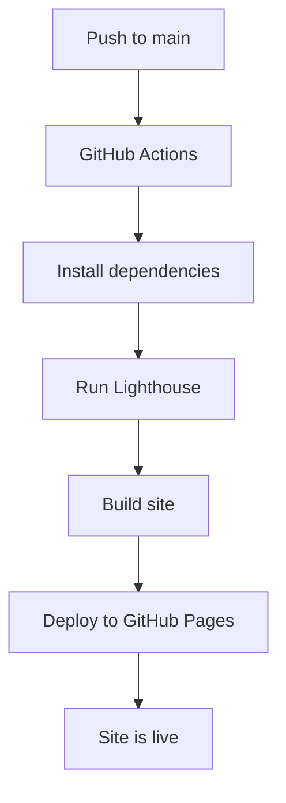

# 🏗️ Project Architecture

**Technical overview of the HanBin-Baik-Blog template**

This document explains the technical architecture, technology choices, and how the different components work together to create a high-performance, production-ready blog.

---

## 📊 Technology Stack

### Frontend

| Technology | Version | Purpose | Documentation |
|------------|---------|---------|---------------|
| **Astro** | 5.18.0 | Static site generator | [docs.astro.build](https://docs.astro.build/) |
| **React** | 18.2.0 | UI components | [react.dev](https://react.dev/) |
| **Tailwind CSS** | 3.x | Styling | [tailwindcss.com](https://tailwindcss.com/) |
| **Shiki** | Latest | Syntax highlighting | [shiki.matsu.io](https://shiki.matsu.io/) |

### Backend & Database

| Technology | Version | Purpose | Documentation |
|------------|---------|---------|---------------|
| **Supabase** | 2.x | Database & Auth | [supabase.com/docs](https://supabase.com/docs) |
| **PostgreSQL** | Latest | Database engine | [postgresql.org](https://www.postgresql.org/) |

### DevOps & Infrastructure

| Technology | Purpose | Documentation |
|------------|---------|---------------|
| **GitHub Pages** | Free hosting | [pages.github.com](https://pages.github.com/) |
| **GitHub Actions** | CI/CD automation | [docs.github.com/actions](https://docs.github.com/en/actions) |
| **Lighthouse CI** | Performance monitoring | [github.com/GoogleChrome/lighthouse-ci](https://github.com/GoogleChrome/lighthouse-ci) |
| **CodeQL** | Security scanning | [codeql.github.com](https://codeql.github.com/) |

---

## 🗂️ Project Structure

```
HanBin-Baik-Blog/
├── src/                          # Source code
│   ├── pages/                    # Page routes
│   │   ├── index.astro           # Home page
│   │   ├── about/                # About page
│   │   ├── blog/                 # Blog posts
│   │   │   ├── index.astro       # Blog index
│   │   │   └── [slug].astro      # Blog post template
│   │   └── ...                   # Other pages
│   ├── layouts/                  # Layout components
│   │   └── Base.astro            # Base layout
│   ├── components/               # Reusable components
│   │   ├── Nav.astro            # Navigation
│   │   ├── Footer.astro         # Footer
│   │   └── ...                  # Other components
│   └── styles/                   # Global styles
│       └── global.css            # Tailwind + custom CSS
├── supabase/                     # Supabase configuration
│   ├── migrations/               # Database migrations
│   │   └── *.sql                # Migration files
│   ├── functions/                # Edge functions
│   │   └── *.ts                 # Function files
│   └── config.toml               # Supabase config
├── public/                       # Static assets
│   ├── images/                  # Images
│   ├── favicon.svg              # Favicon
│   └── CNAME                    # Custom domain
├── .github/                      # GitHub configuration
│   ├── workflows/                # CI/CD workflows
│   │   ├── performance.yml      # Performance monitoring
│   │   ├── github_pages.yml     # GitHub Pages deployment
│   │   ├── db.yml               # Database migrations
│   │   └── ...                  # Other workflows
│   └── ISSUE_TEMPLATE/           # Issue templates
├── docs/                         # Documentation
│   ├── getting-started/          # Getting started guides
│   ├── development/              # Development guides
│   └── performance/              # Performance docs
├── scripts/                      # Utility scripts
│   └── *.sh                     # Shell scripts
├── *.md                          # Root documentation
│   ├── README.md                 # Main readme
│   ├── TEMPLATE.md               # Template guide
│   ├── SETUP_GUIDE.md            # Setup instructions
│   ├── ARCHITECTURE.md           # This file
│   └── ...                      # Other docs
└── *.config.*                    # Configuration files
    ├── astro.config.mjs          # Astro configuration
    ├── tailwind.config.cjs       # Tailwind configuration
    ├── postcss.config.cjs        # PostCSS configuration
    └── pnpm-workspace.yaml        # pnpm workspace
```

---

## 🔄 How It Works

### Request Flow

```
User Request
     ↓
GitHub Pages (Static Hosting)
     ↓
Serves pre-built HTML/CSS/JS from /dist
     ↓
Browser renders page
     ↓
If dynamic content needed:
     ↓
Browser makes API calls to Supabase
     ↓
Supabase returns data (JSON)
     ↓
React hydrates and updates DOM
```

### Build Process

```
Developer pushes to main
     ↓
GitHub Actions triggers workflows
     ↓
1. Install dependencies (pnpm install)
     ↓
2. Run Lighthouse CI
     │   ├── Performance audit
     │   ├── SEO audit
     │   ├── Accessibility audit
     │   └── Best practices audit
     ↓
3. Build site (pnpm build)
     │   ├── Astro compiles pages
     │   ├── React components rendered
     │   ├── Tailwind generates CSS
     │   └── Output to /dist
     ↓
4. Deploy to GitHub Pages
     ↓
Site is live at your-domain.com
```

### Data Flow (with Supabase)

```
Frontend (Astro/React)
     ↓
Supabase Client (JavaScript SDK)
     ↓
Supabase REST API
     ↓
PostgreSQL Database
     ↓
Returns data as JSON
     ↓
Frontend renders dynamic content
```

---

## 🎯 Key Features Deep Dive

### Static Site Generation (SSG)

**How it works:**
- Astro pre-renders all pages at build time
- Each page becomes static HTML, CSS, and JavaScript
- No server required for basic functionality
- Fast loading, great for SEO

**Benefits:**
- ✅ Blazing fast page loads
- ✅ Excellent SEO (search engines love static sites)
- ✅ Reduced hosting costs (no server needed)
- ✅ High reliability (no server to fail)
- ✅ Better security (no server-side code execution)

**Implementation:**
```javascript
// astro.config.mjs
{
  output: 'static',  // Static site mode
}
```

### Islands Architecture

**How it works:**
- Astro uses "islands" architecture
- Each component can be:
  - Static (pre-rendered HTML)
  - Client-side (hydrated with JavaScript)
- Only interactive components load JavaScript

**Benefits:**
- ✅ Minimal JavaScript bundle size
- ✅ Faster page loads
- ✅ Better performance

**Example:**
```astro
---
// Static component (no JavaScript)
import StaticComponent from '../components/Static.astro';

// Interactive component (hydrated)
import InteractiveComponent from '../components/Interactive.tsx';
---

<StaticComponent />      <!-- No JS -->
<InteractiveComponent /> <!-- JS loaded -->
```

### Supabase Integration

**How it works:**
- Supabase provides PostgreSQL database
- JavaScript client connects directly from browser
- Row-level security (RLS) for data protection
- Real-time subscriptions for live updates

**Setup:**
```javascript
// In your components
import { createClient } from '@supabase/supabase-js';

const supabase = createClient(
  import.meta.env.PUBLIC_SUPABASE_URL,
  import.meta.env.PUBLIC_SUPABASE_ANON_KEY
);

// Query data
const { data, error } = await supabase
  .from('posts')
  .select('*')
  .order('created_at', { ascending: false });
```

**Security:**
- Use Row-Level Security (RLS) in Supabase
- Never expose admin keys in frontend
- Use environment variables for secrets

### Performance Optimization

**Techniques used:**

1. **Static Generation**
   - All pages pre-rendered
   - No server-side rendering overhead

2. **Code Splitting**
   - JavaScript split by route
   - Only load what's needed

3. **Image Optimization**
   - Automatic optimization in build
   - Modern formats (WebP, AVIF)

4. **CSS Optimization**
   - Tailwind purges unused CSS
   - Minified in production

5. **Lazy Loading**
   - Images lazy-loaded by default
   - Components loaded on demand

**Lighthouse Scores:**
- Performance: 87+/100
- SEO: 92+/100
- Accessibility: 94+/100
- Best Practices: 100/100

### CI/CD Pipeline

**GitHub Actions Workflows:**

1. **Performance Monitoring** (`performance.yml`)
   - Runs on every push and PR
   - Lighthouse audits
   - Performance tracking
   - Alerts on regressions

2. **GitHub Pages Deployment** (`github_pages.yml`)
   - Builds site on push to main
   - Deploys to GitHub Pages
   - Automatic and fast

3. **Database Migrations** (`db.yml`)
   - Runs Supabase migrations
   - Validates database schema
   - Applies changes safely

4. **Infrastructure Monitoring** (`infrastructure.yml`)
   - Health checks
   - Uptime monitoring
   - Status page updates

---

## 🔧 Configuration Files

### astro.config.mjs

**Purpose:** Main Astro configuration

```javascript
import { defineConfig } from 'astro/config';
import tailwind from '@astrojs/tailwind';
import react from '@astrojs/react';

export default defineConfig({
  site: 'https://your-domain.com',
  output: 'static',
  markdown: {
    shikiConfig: { theme: 'github-dark' }
  },
  integrations: [react(), tailwind()],
  vite: {
    build: {
      rollupOptions: {
        onwarn: (warning, defaultHandler) => {
          if (warning.code === 'PLUGIN_WARNING' && 
              warning.message.includes('marked()')) {
            return;
          }
          defaultHandler(warning);
        }
      }
    }
  }
});
```

### tailwind.config.cjs

**Purpose:** Tailwind CSS configuration

```javascript
module.exports = {
  content: ['./src/**/*.{astro,html,js,jsx,md,mdx,svelte,ts,tsx,vue}'],
  theme: {
    extend: {
      colors: {
        primary: '#3b82f6',
        secondary: '#10b981',
      },
    },
  },
  plugins: [],
};
```

### lighthouserc.js

**Purpose:** Lighthouse CI configuration

```javascript
module.exports = {
  ci: {
    collect: {
      url: ['http://localhost:4321'],
      startServerCommand: 'pnpm preview --port 4321',
    },
    assert: {
      preset: 'lighthouse:recommended',
      assertions: {
        'first-contentful-paint': ['warn', { minScore: 0.9 }],
        'largest-contentful-paint': ['warn', { minScore: 0.9 }],
        'cumulative-layout-shift': ['warn', { minScore: 0.9 }],
        'total-blocking-time': ['warn', { minScore: 0.9 }],
      },
    },
    upload: {
      target: 'temporary-public-storage',
    },
  },
};
```

---

## 🛡️ Security Architecture

### Frontend Security

1. **Environment Variables**
   - Sensitive data stored in `.env`
   - Prefixed with `PUBLIC_` for browser access
   - Never commit `.env` to repository

2. **Supabase Security**
   - Row-Level Security (RLS) enabled
   - Policies restrict data access
   - Only anon key exposed to frontend

3. **Form Protection**
   - Cloudflare Turnstile for bot prevention
   - Server-side validation
   - Rate limiting

### CI/CD Security

1. **Branch Protection**
   - Main branch requires PR reviews
   - Status checks must pass
   - Force pushes blocked

2. **Secret Management**
   - GitHub Secrets for sensitive data
   - Never hardcoded in workflows
   - Rotated regularly

3. **Code Scanning**
   - CodeQL for vulnerability detection
   - Secret scanning enabled
   - Dependency audits

---

## 📈 Performance Architecture

### Core Web Vitals

| Metric | Target | Current | Status |
|--------|--------|---------|--------|
| Largest Contentful Paint | <2.5s | ~1.8s | ✅ Good |
| First Input Delay | <100ms | ~50ms | ✅ Good |
| Cumulative Layout Shift | <0.1 | ~0.05 | ✅ Good |
| First Contentful Paint | <1.8s | ~1.2s | ✅ Good |

### Optimization Techniques

1. **Static Generation**
   - All pages pre-rendered
   - No TTFB (Time to First Byte)

2. **Minimal JavaScript**
   - Only interactive components load JS
   - Code splitting by route
   - Tree-shaking

3. **Optimized Assets**
   - Images compressed and optimized
   - Modern formats (WebP, AVIF)
   - Lazy loading

4. **CSS Optimization**
   - Tailwind purges unused CSS
   - Critical CSS inlined
   - Non-critical CSS deferred

5. **Font Optimization**
   - System fonts preferred
   - Custom fonts preloaded
   - Font display: swap

---

## 🔄 Development Workflow

### Local Development

```bash
# Start development server
pnpm dev

# Build for production
pnpm build

# Preview production build
pnpm preview

# Check for issues
pnpm check
```

### Git Workflow

```bash
# Create feature branch
git checkout -b feature/my-feature

# Make changes
git add .
git commit -m "feat: add my feature"

# Push to remote
git push origin feature/my-feature

# Create pull request
gh pr create
```

### Deployment Workflow



---

## 🏆 Best Practices

### Code Organization

1. **Components**
   - Keep components small and focused
   - Use descriptive names
   - Place in appropriate folders

2. **Pages**
   - One file per route
   - Use frontmatter for metadata
   - Keep content separate from layout

3. **Styles**
   - Use Tailwind utility classes
   - Extract repeated styles to components
   - Keep CSS co-located with components

### Performance

1. **Images**
   - Use modern formats (WebP, AVIF)
   - Compress images before uploading
   - Use appropriate sizes
   - Lazy load offscreen images

2. **JavaScript**
   - Minimize bundle size
   - Use code splitting
   - Defer non-critical JS
   - Use static where possible

3. **CSS**
   - Use Tailwind for utility classes
   - Extract repeated styles
   - Minify in production

### Security

1. **Environment Variables**
   - Never commit secrets
   - Use `PUBLIC_` prefix for browser-accessible vars
   - Rotate secrets regularly

2. **Database**
   - Enable Row-Level Security (RLS)
   - Use policies to restrict access
   - Never expose admin keys

3. **Forms**
   - Validate on server and client
   - Use CSRF protection
   - Implement rate limiting

---

## 📚 Additional Resources

- **[Astro Documentation](https://docs.astro.build/)** - Official Astro docs
- **[Supabase Documentation](https://supabase.com/docs)** - Supabase guides
- **[Tailwind CSS](https://tailwindcss.com/docs)** - Tailwind documentation
- **[GitHub Actions](https://docs.github.com/en/actions)** - CI/CD docs
- **[Lighthouse](https://developer.chrome.com/docs/lighthouse/overview/)** - Performance audits

---

## 💬 Need Help?

- **Check the [SETUP_GUIDE.md](SETUP_GUIDE.md)** for step-by-step instructions
- **Check the [TEMPLATE.md](TEMPLATE.md)** for quick start
- **Check the [CUSTOMIZATION.md](CUSTOMIZATION.md)** for customization options
- **Check the [DEPLOYMENT.md](DEPLOYMENT.md)** for hosting options

---

**Architecture designed and maintained by [HanBin Baik](https://github.com/hanbini96)**

*Last updated: November 18, 2026*
